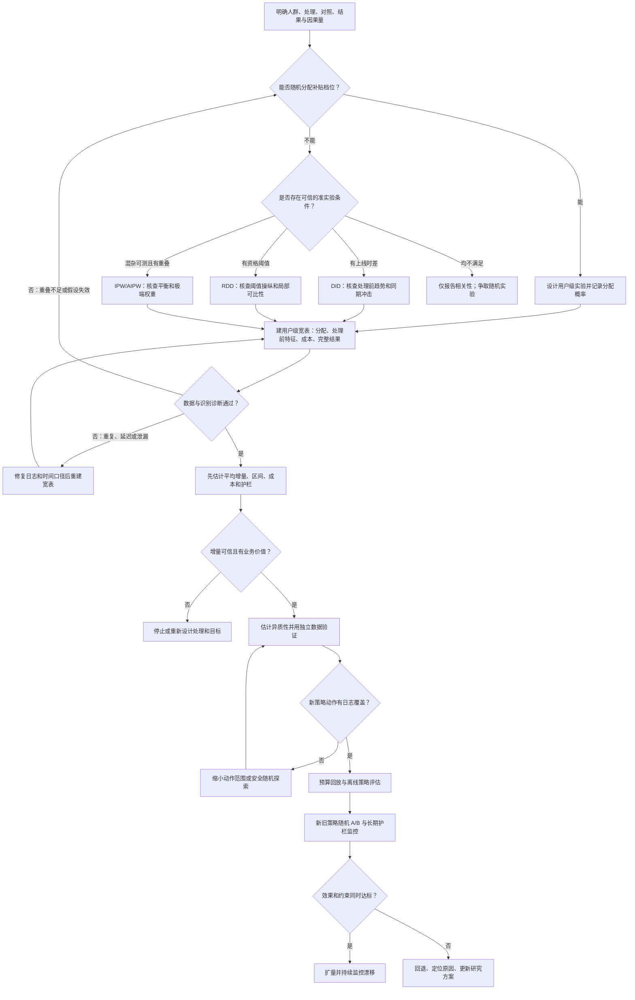

# 因果推断：用户增长与金币补贴

> 核心问题：用户领取金币后活跃，不等于金币使其活跃。因果推断要估计“同一类用户若不给补贴，会怎样”，并把识别假设、估计方法和业务决策连起来。

## 1. 从业务问题到因果量

设 $T\in\{0,1\}$ 表示是否**被分配**补贴，$Y(1)$、$Y(0)$ 表示同一用户在两种处理下的潜在结果，例如未来 7 日活跃天数。只能观察 $Y=TY(1)+(1-T)Y(0)$，无法同时观察同一用户的两种结果，这就是反事实问题。

| 因果量 | 数学定义 | 业务解释 |
| --- | --- | --- |
| ATE（Average Treatment Effect，平均处理效应） | $\mathbb E[Y(1)-Y(0)]$ | 对目标总体平均发券能增加多少活跃 |
| ATT（Average Treatment Effect on the Treated，处理组平均处理效应） | $\mathbb E[Y(1)-Y(0)\mid T=1]$ | 已被分配补贴的人群中，平均新增多少活跃 |
| CATE（Conditional Average Treatment Effect，条件平均处理效应） | $\tau(x)=\mathbb E[Y(1)-Y(0)\mid X=x]$ | 具有特征 $x$ 的用户增量效果；也称条件 uplift |

若补贴有多个金额 $a\in\{0,a_1,\ldots,a_K\}$，定义相对不补贴的剂量效果 $\tau(x,a)=\mathbb E[Y(a)-Y(0)\mid X=x]$。决策时还要扣除成本：若单位增量活跃价值为 $v$，可比较 $v\tau(x,a)-c(x,a)$，并施加预算、频控与风险约束。**预测自然活跃率 $\mathbb P(Y=1\mid X=x)$ 不能替代 $\tau(x,a)$**：高活跃用户可能无需补贴也会回来。

## 2. 先画因果关系，再挑方法

一个常见的简化有向无环图（DAG，Directed Acyclic Graph）是 $X\rightarrow T$、$X\rightarrow Y$、$T\rightarrow Y$。其中 $X$ 是处理前的历史活跃、渠道、设备等，同时影响投放与结果，是需要处理的混杂因素。若“领取金币”发生在分配之后，它可能位于 $T\rightarrow\text{领取}\rightarrow Y$ 的路径上；按领取与否筛选用户会引入处理后选择偏差，不能直接解释为分配补贴的效果。

识别观察数据中的 ATE/CATE 通常需要：

1. **一致性**：用户实际接受某处理时，观测结果等于该处理下的潜在结果；金额、展示、有效期等处理版本须定义清楚。
2. **无干扰**：一人的处理不改变另一人的结果。邀请返利、社交传播可能违反；要考虑簇随机化或网络效应。
3. **条件可交换性**：给定处理前协变量 $X$ 后，处理分配与潜在结果独立，即 $\{Y(0),Y(1)\}\perp T\mid X$。随机分配最直接；观察数据只能基于业务和数据对该假设辩护，无法仅凭模型检验保证。
4. **重叠性**：目标人群中每种处理都有非零分配概率，$0<e(X)=\mathbb P(T=1\mid X)<1$。若高风险用户从不发券，日志不能可靠估计“给他们发券”的效果。

**实际检查**：核对处理、结果和协变量的时间顺序；列出可能遗漏的用户意愿、运营规则、渠道；查看各人群处理概率和协变量平衡。不要把补贴后点击、领取、任务完成放进处理前协变量。留存标签必须等观察窗结束后再使用。

### 假设、前提与问题总结表

先区分三类条件：**定义条件**决定“处理和结果是什么”；**识别假设**决定能否把比较解释为因果效果；**估计与实施前提**决定公式、标准误和上线结果是否可信。诊断通过只能增加可信度，通常不能从数据中证明所有反事实假设。

| 类别 | 假设或前提 | 适用方法与作用 | 失效时常见问题 | 检查与处理 |
| --- | --- | --- | --- | --- |
| 定义 | **目标人群、处理版本、对照和结果窗固定** | 所有方法；保证估计的是同一个问题 | 1 元券与 2 元券混为“发券”；7 日留存窗不一致；效果不可解释 | 预先写口径；记录金额、资格、发放/展示、时区与观察期；不同处理版本分开估计 |
| 定义 | **一致性**：接受处理 $t$ 时 $Y=Y(t)$ | 潜在结果框架；将观测结果对应到指定处理 | 同名处理实际体验不同，或分配与到账混用 | 定义分配、曝光、到账各自的处理；主分析按原分配档位做 ITT |
| 识别 | **无干扰/稳定处理**：一人的处理不改变他人的结果 | 个体随机实验及大多数观察数据方法 | 邀请返利、社交传播、供给挤占使对照组也受影响 | 画传播链；按社群/地区随机化或明确估计溢出效应；监测组间交叉 |
| 识别 | **随机分配正确执行** | 随机实验的组均值差识别 ITT | 跨端串组、按实验后行为筛样本、样本比例异常 | 从原始分配日志核对随机化单位、分流比例、组间处理前平衡；修复污染后重算 |
| 识别 | **条件可交换性/无未测混杂**：$\{Y(0),Y(1)\}\perp T\mid X$ | 回归调整、IPW、AIPW、匹配；用已记录的处理前特征使组别可比 | 运营按未记录的活跃意愿发券，模型再准也可能有偏 | 列出投放规则和共同原因；只放处理前协变量；做安慰剂与敏感性分析；必要时改做实验 |
| 识别 | **重叠性/正值性**：目标人群中各处理有正概率 | 回归调整、IPW、AIPW、匹配及离线策略评估 | 某类用户从不发券，反事实只能外推；权重爆炸 | 画倾向得分分布、统计每档覆盖与有效样本量；限制到共同支持人群或补充安全探索 |
| 识别 | **平行趋势及无差异化同期冲击** | DID；用对照组时间变化近似处理组反事实变化 | 活动上线同时发生渠道投放或版本发布，变化之差误判为补贴效果 | 画多期处理前趋势、事件研究、安慰剂时点；排查同期政策；更换对照组做稳健性分析 |
| 识别 | **阈值附近连续、不可精准操纵** | RDD；在资格阈值附近识别局部效果 | 用户或运营调分跨线，阈值同时触发其他奖励 | 查运行变量密度和处理前协变量跳跃；改变带宽；确认阈值规则；只报告局部效果 |
| 识别 | **工具外生、相关、排除限制与单调性** | IV；利用鼓励变量引起的实际领取差异 | 通知本身改变活跃、第一阶段太弱、有人反向响应 | 检查第一阶段并论证业务路径；排查工具对结果的直接影响；明确结果通常是依从者局部效果 |
| 数据 | **时间顺序与结果完整** | 所有方法；保证 $X$ 在处理前、$Y$ 在处理后 | 领取/点击泄漏进特征；不同组日志延迟不同；近期用户被当作 0 活跃 | 以分配时刻截断特征；固定自然日和日志水位；比较各组缺失率，不把未到齐当 0 |
| 推断 | **独立性与正确的方差单位** | 置信区间、显著性检验和离线评估 | 同一用户多次记录或按城市分流却按用户算标准误，区间过窄 | 按随机化/政策单位聚类或重抽样；多次触达先定义分析单位 |
| 建模 | **模型足够合适、验证独立** | 回归、IPW、AIPW、CATE/uplift | 结果/倾向模型错设、过拟合；在同一批数据选策略又报告收益 | 分时间/用户验证、交叉拟合、概率校准；报告模型规格与敏感性 |
| 决策 | **新策略动作有日志支持，成本口径可比** | IPS/DR 离线策略评估、预算优化 | 给历史从未尝试的金额，离线收益无法识别；漏算到账成本 | 记录决策概率；检查权重与覆盖；预算回放；以新旧策略随机 A/B 最终验证 |

**判断顺序**：先检查定义与时间线，再检查对应设计的识别假设，最后检查模型和方差。若关键识别假设不成立，缩小目标人群、改变实验/准实验设计，或将结果明确标为相关性；调参和显著性检验不能修复识别失败。

### 2.1 定义条件：先确认到底在估计哪个效果

**目标人群、处理版本与结果窗口**。写清用户何时进入研究、当时是否有资格领券、被分配的是 0/1/2 元还是“实际到账金额”，以及结果从何时起算。若处理组包含不同有效期、展示样式和金额，估计的是这些版本的混合效果，不能解释为“1 元金币”的单一效果。若新用户与老用户混在一起，ATE 的数值会随人群占比变化。建议用一张研究方案表固定：入组规则、处理/对照、主指标、观察窗、分析冻结时间、排除规则。新增分析口径应标注为探索性。

**一致性**要求“实际接受处理 $t$ 的观测结果就是 $Y(t)$”。它依赖处理版本被定义得足够具体：分配补贴、看到补贴入口、点击领取、到账是不同事件。研究“推出分配策略”时把分配作为处理，未领取者也留在原组；研究“实际领取”的效果则涉及用户自主选择，需额外识别设计。若到账延迟或券过期，至少报告各档的实际触达与到账率，使读者知道 ITT 对应怎样的实施强度。

**无干扰**要求一个人的潜在结果只取决于自己的处理。邀请返利可能使受补贴用户拉来未受补贴好友；平台内容供给有限时，补贴一组用户也可能挤占另一组的曝光。此时普通用户级实验的组间差可能低估或改变政策整体效果。可先用业务链路判断传播范围，再考虑按社群、城市或时间块随机化，并按该单位估计方差；若要研究网络溢出，应显式定义直接效果和溢出效果，不能仍套单用户潜在结果式。

### 2.2 识别条件：比较组为何能代表反事实

**随机分配**让分配组在期望上与潜在结果无关，因而分配组均值差可识别 ITT。落实时要从**原始随机化日志**确定分母，而不是从“成功展示”“领取成功”等处理后日志反推样本。验收顺序是：查随机化单位与跨端稳定性 → 查样本比例异常 → 查处理前变量平衡 → 查后续结果是否完整。处理前平衡偶有随机波动，单项显著不必然说明实验失败；但系统性差异、分流比例异常或按实验后条件筛人需要追查机制。

**条件可交换性**用于观察数据：给定充分的处理前 $X$ 后，发券与不发券用户的未观测潜在结果应可比。构建 $X$ 时从业务规则倒推共同原因，例如历史活跃影响投放也影响未来活跃；渠道和设备可能同时影响两者。反过来，领取、点击、任务完成若发生在发券之后，可能是中介；按它们筛选或调整，会改变目标效应，甚至打开碰撞点路径。列出每个变量的生成时间和因果角色。无未测混杂不能靠平衡检验“证明”；若运营按未记录的意愿或人工判断投放，应做敏感性分析或改用随机设计。

**重叠性**要求在目标人群的每类特征上都有机会看到两种处理。它有两层：理论上处理概率非零，实践中也要有足够样本。若规则规定“低于 3 日活跃才发券”，高活跃用户的发券效果在历史日志中没有支持；回归模型给出的高活跃用户发券收益只是外推。画各组倾向得分直方图，按关键人群统计每档人数，检查最大权重和有效样本量。可把目标限定到共同支持区间并重新说明待估因果量，或设计安全随机探索；不能用裁剪权重来声称原全量效果已被识别。

**DID 的平行趋势**说的是：若没有补贴上线，处理地区和对照地区的结果变化本应相同，并不要求两地活跃水平相同。上线前多期走势相近是支持证据，但处理组可能恰因异常下跌而被选中，之后自然回升；同期广告投放或版本更新也会造成差异化趋势。画上线前后多期曲线、标记其他活动、做假上线日检验，并在政策分配单位上计算不确定性。若分批上线且效果随批次/时间异质，选能处理这一结构的 DID 估计量。

**RDD 的阈值连续性**利用资格线附近用户的近似可比性：没有处理时，潜在结果应随评分平滑变化，只有处理概率在阈值处突变。检查阈值附近评分是否异常堆积、处理前特征是否突变、其他奖励是否共用阈值；改变带宽和局部线性拟合规格看结果是否稳定。即使诊断良好，估计仍主要回答“资格线附近用户”的效果，不宜直接外推到远离阈值的用户。

**IV 的外生性、相关性、排除限制和单调性**分别回答：鼓励变量是否像随机分配、是否真的改变领取、是否只能通过领取影响活跃、是否不存在因鼓励反而拒绝领取的反向响应者。比如随机推送“可领金币”通知可能显著提高领取，但通知本身也提醒用户打开应用，排除限制便可疑。先报告第一阶段领取率差，再论证通知到活跃的所有路径；若排除限制不可信，报告通知分配的 ITT 更稳妥。标准 IV 在这些条件下通常只识别受鼓励才领取的依从者效果。

### 2.3 数据与推断前提：即使设计正确也可能算错

**时间顺序和结果完整性**。每个处理前特征应有独立的生成时刻，晚于分配时间的值不可回填到历史样本。结果窗口按固定时区和完整日志水位生成；刚入组用户没有满 7 天，属于尚未成熟的样本，不能记为 0。若部分成熟用户结果仍缺失，比较不同处理组的缺失率和原因。只保留“结果可观测用户”相当于按后续状态筛选，可能破坏随机化；需先修复日志，必要时做缺失机制的敏感性分析。

**独立性和方差单位**。若按城市投放政策，数百万用户也不等于数百万个独立实验单位；同一城市的结果共受天气、活动和市场变化影响。用户反复曝光、家庭账号共享、社交网络传播也会产生相关性。点估计有时仍可计算，但按独立用户公式给出的标准误可能过小。记录实际随机化或政策实施单位，按簇聚类估计标准误；簇数很少时需更谨慎的方法和更宽的解释范围。多金额、多指标和多次查看还需预先控制重复检验风险。

**模型、验证和策略支持**。回归调整要检查结果模型，IPW 要检查倾向模型及加权平衡，AIPW 要同时检查两类模型与重叠。灵活模型估计倾向和结果时可做交叉拟合，避免同一观测既训练干扰模型又计算其残差。CATE 模型还需在独立随机数据上看分桶增量；普通预测准确率不等于增量预测准确。新策略若给旧日志从未尝试的金额，离线 IPS/DR 没有可靠识别基础。应限制动作范围、补采随机日志，再做预算回放和新旧策略 A/B。

**一份研究的最低交付**：口径与因果量、识别假设及理由、样本流转与各组数量、核心诊断图/表、点估计和置信区间、敏感性分析、适用人群与上线边界。任何关键假设只能部分验证时，应在结论中明确该不确定性，而不是只给出一个“显著提升”的数字。

## 3. 随机实验：优先采用的识别设计

按用户稳定随机分配“不给补贴”和一个或多个金额，记录实验资格、分配时间、实际展示/到账、分配概率和后续结果。用户级随机化时，同一用户的所有端与请求应保持同组。预先规定主指标（如 7 日活跃天数或去重增量 DAU）、成本与体验护栏，先检查样本比例异常、分流污染和日志缺失。

二元随机处理下，意向性处理效应 ITT（Intention-to-Treat Effect，按分配分析的处理效应）可由组均值差估计：

$$
\widehat{\tau}_{\mathrm{ITT}}=\bar Y_{T=1}-\bar Y_{T=0}.
$$

即使部分用户没有领取，也保留在原分配组中；这对应“推出发券策略”的效果。若要估计实际领取的因果效果，不能简单比较领取者与未领取者；在随机分配影响结果**只通过领取**、单调性等额外假设成立时，可考虑工具变量或鼓励设计，估计的是特定依从人群的局部效应。

**提升精度**：随机化前的活跃天数可作为协变量做回归调整，或用 CUPED（Controlled-experiment Using Pre-Experiment Data，利用实验前数据降方差）构造 $Y^{\rm adj}=Y-\theta(X-\bar X)$，其中 $\theta\approx\operatorname{Cov}(Y,X)/\operatorname{Var}(X)$。只能使用处理前数据；它降低方差，不能修复分流错误。置信区间和检验见 [统计基础与实验检验](01-统计基础与实验检验.md)。

## 4. 非随机数据：先写清识别假设

| 方法 | 核心估计思路 | 适用条件与主要风险 |
| --- | --- | --- |
| 回归调整 | 估计 $m_t(x)=\mathbb E[Y\mid T=t,X=x]$，再平均 $m_1(X)-m_0(X)$ | 需充分测量混杂因素，结果模型错设会偏 |
| 倾向得分加权 IPW（Inverse Probability Weighting，逆概率加权） | 估计 $e(x)$，处理组权重 $1/e(X)$、对照组权重 $1/(1-e(X))$ | 需条件可交换性与重叠性；极端权重使方差很大 |
| 双重稳健 AIPW（Augmented Inverse Probability Weighting，增强逆概率加权） | 结合结果模型 $m_t(x)$ 与倾向模型 $e(x)$，用加权残差修正 | 在标准条件下，两类模型有一类正确可一致；重叠性不足仍无解，机器学习拟合时宜交叉拟合 |
| 匹配/分层 | 按处理前特征或倾向得分找可比用户/分层比较 | 只能平衡已观测特征；要报告匹配丢失的人群及目标总体变化 |
| 双重差分 DID（Difference-in-Differences，双重差分） | 比较处理前后变化之差，$\widehat\tau=(\bar Y_{1,\rm post}-\bar Y_{1,\rm pre})-(\bar Y_{0,\rm post}-\bar Y_{0,\rm pre})$ | 关键是无处理时的平行趋势；需检查处理前趋势、同期冲击和提前反应 |
| 断点回归 RDD（Regression Discontinuity Design，断点回归设计） | 资格按阈值决定时，比较阈值两侧邻近用户 | 估计阈值附近的局部效果；阈值不可被精准操纵，其他规则不能同点跳变 |
| 工具变量 IV（Instrumental Variables，工具变量） | 用影响补贴但不直接影响结果的外生变量识别效果 | 需要相关性、排除限制等；常估计局部平均处理效应，工具是否有效需业务论证 |

以 AIPW 的 ATE 估计为例，令 $e_i=e(X_i)$、$m_{ti}=m_t(X_i)$：

$$
\widehat\tau_{\rm AIPW}=\frac1N\sum_{i=1}^N\left[m_{1i}-m_{0i}+\frac{T_i(Y_i-m_{1i})}{e_i}-\frac{(1-T_i)(Y_i-m_{0i})}{1-e_i}\right].
$$

这不是“无条件双保险”：未观测混杂、处理后变量和没有重叠的人群都不能由公式消除。用灵活模型估计干扰参数时，应在不同折上拟合与评估，降低过拟合带来的偏差。

### 4.1 回归调整：用处理前特征补齐反事实

**解决什么问题**：补贴组原本就比未补贴组活跃，直接相减混入了用户差异。回归调整先在相同的处理前特征 $X$ 下预测两种处理的结果，再对同一目标人群取平均。随机实验中也可用它降低方差，但随机化本身才提供因果识别。

**怎么做**：分别拟合 $m_1(x)=\mathbb E[Y\mid T=1,X=x]$、$m_0(x)=\mathbb E[Y\mid T=0,X=x]$，对每位目标用户预测 $\hat m_1(X_i)-\hat m_0(X_i)$，平均得到 $\hat\tau_{\rm reg}=N^{-1}\sum_i[\hat m_1(X_i)-\hat m_0(X_i)]$。也可在同一模型中加入处理变量和处理×特征交互。模型可以是线性回归、逻辑回归或树，但二元结果的概率模型输出要校准。

**例子**：运营更常给近 7 日低活跃用户发券。把发券前活跃、渠道、设备等放进模型，比较同一特征组合下“发券”和“不发券”的预测活跃。**前提**是关键混杂因素已记录，且两组在这些特征上有可比样本；若结果模型错设，估计仍可能有偏。检查分层残差、样本外预测、共同支持范围和不同模型规格的敏感性。不要加入发券后的领取或点击。

### 4.2 IPW：通过加权重建可比人群

**解决什么问题**：两组的特征分布不同，且用单一结果模型描述 $Y$ 与 $X$ 的关系可能很难。IPW 不直接建结果模型，而是让原本不易被分到其实际组别的用户获得更大权重，构造特征分布相近的伪总体。

**怎么做**：用处理前特征估计倾向得分 $e(x)=\mathbb P(T=1\mid X=x)$。ATE 的未归一化权重为 $w_i=T_i/e(X_i)+(1-T_i)/[1-e(X_i)]$；分别对处理组和对照组求加权结果均值再相减。若目标是 ATT，权重和目标人群不同：处理组权重为 1，对照组可用 $e(X_i)/[1-e(X_i)]$。明确目标因果量，不能把 ATE 与 ATT 权重混用。

**例子**：历史发券规则偏向低活跃、特定渠道。估计每个用户被发券的概率后，对低概率却实际发券的用户加较大权重。检查加权前后的标准化均值差、倾向得分重叠、最大权重和有效样本量。若某类用户发券概率接近 0，权重会爆炸；可限制分析到共同支持人群，并说明目标人群改变。裁剪权重降低方差但引入偏差，应报告阈值及敏感性。IPW 依然无法平衡未记录的用户意愿。

### 4.3 AIPW：结合结果模型与分配模型

**解决什么问题**：纯回归调整依赖 $m_t(x)$，纯 IPW 依赖 $e(x)$；AIPW 将两者组合，用“结果预测 + 加权预测残差”估计平均效果。上方公式中的 $m_{1i}-m_{0i}$ 给出每人的初始反事实差，两项残差校正模型在实际观测组上的偏差。

**怎么做**：① 用处理前特征拟合 $e(x)$、$m_0(x)$、$m_1(x)$；② 用交叉拟合，在未参与该模型训练的折上生成预测；③ 代入上方公式，按用户计算影响函数值、平均和标准误；④ 检查倾向得分重叠、极端权重、结果模型拟合及协变量平衡。随机实验若分配概率已知，应优先用真实分配概率，而不是重新估计一套可能有误的概率。

**边界**：在条件可交换性、重叠性等成立且常规正则条件下，结果模型或倾向模型有一方正确可得到一致估计；两者都严重错设、漏掉混杂或没有支持集时仍会失败。它回答的是目标人群的平均效果，不自动给出可靠的每用户 CATE。

### 4.4 匹配与分层：只比较“看起来相近”的用户

**解决什么问题**：原始两组差异太大，直接比较缺少可解释的对照。匹配为每名处理用户寻找处理前特征相近的未处理用户；分层则把用户划进相近的倾向得分区间，在层内比较，再按目标人群加权汇总。

**怎么做**：先固定匹配变量或倾向模型，再规定最近邻、是否允许重复使用对照、最大距离（caliper）和是否丢弃无匹配用户。匹配后看每个处理前变量的标准化差异和共同支持；同一对照被重复使用、匹配成对或簇内相关时，区间估计须反映这种依赖。分层时检查每层两组人数和平衡，过薄的层应合并或排除。

**例子与边界**：给每名被发 1 元的用户找发券前活跃、渠道、设备相似的 0 元用户。若高价值用户全部发券，无匹配对照，就不能估计这部分用户“不发券会怎样”；报告被丢弃比例与估计对象变成了谁。匹配只能处理已测量的混杂，不保证因果可比。

### 4.5 DID：扣除共同时间趋势

**解决什么问题**：某城市先推出金币活动，另一个相似城市暂未推出；上线后活跃本来可能因季节、节假日同时变化。DID 以未上线城市的同期变化近似已上线城市若未上线时的变化，再做“变化之差”。

**怎么做**：固定处理组、对照组、上线时点及处理前后窗口，先画至少多个处理前时点的趋势，再估计 $[\bar Y_{1,\rm post}-\bar Y_{1,\rm pre}]-[\bar Y_{0,\rm post}-\bar Y_{0,\rm pre}]$。在面板数据中可用单位固定效应和时间固定效应实现；标准误通常按政策分配单位（如城市）聚类。若分批上线，处理效应随时间或批次变化，应采用与分批处理相适应的估计方法，避免直接把传统双向固定效应系数当作简单平均效果。

**关键假设**：没有处理时两组应具有平行的结果趋势；还要排除差异化同期活动、提前反应和组间溢出。处理前趋势相近只是支持证据，不是证明。可做事件研究图、假上线日/假结果的安慰剂检验，以及更换对照地区的敏感性分析。若政策按“近期活跃突然下跌的城市”推出，回归均值可能使 DID 失真。

### 4.6 RDD：利用资格阈值附近的近似随机性

**解决什么问题**：规则规定发券前活跃分数低于某阈值才能领金币。阈值两侧非常接近的用户，处理资格突然变化，可用阈值附近结果的跳跃估计局部因果效果。

**怎么做**：令运行变量 $R$ 为处理前评分、阈值为 $c$。阈值右侧减左侧的结果跳跃为 $\Delta_Y=\lim_{r\downarrow c}\mathbb E[Y\mid R=r]-\lim_{r\uparrow c}\mathbb E[Y\mid R=r]$。若右侧接受处理、左侧不接受，锐断点的局部处理效应就是 $\Delta_Y$；若低于阈值者接受处理，则局部处理效应为 $-\Delta_Y$。实践中在阈值两侧选带宽，用局部线性回归分别拟合并比较截距；报告不同带宽、核权重、协变量规格的稳健性。若过线只是改变发券概率，模糊断点要用结果跳跃除以处理概率跳跃，并额外满足工具变量式假设。

**关键假设与边界**：用户不能精准操纵评分跨线；阈值两侧的潜在结果及其他规则应连续。检查运行变量在阈值处是否堆积、处理前特征是否跳变、是否有其他政策共用阈值。结论主要适用于阈值附近，不能直接推出全平台平均效果。

### 4.7 IV：处理“实际接受补贴由用户自己选择”的问题

**解决什么问题**：即使随机分配补贴，部分用户不打开页面或不领取；实际领取 $D$ 与活跃意愿相关，直接比较领取与未领取者会有选择偏差。若有外生的分配或鼓励变量 $Z$，可用它引起的领取变化识别实际领取的局部效果。

**怎么做**：二元随机鼓励且满足假设时，Wald 比率为 $\tau_{\rm IV}=[\mathbb E(Y\mid Z=1)-\mathbb E(Y\mid Z=0)]/[\mathbb E(D\mid Z=1)-\mathbb E(D\mid Z=0)]$。分母是第一阶段，必须足够强；分子是鼓励对结果的意向性效果。含协变量时可用两阶段最小二乘，但标准误不能把第一阶段预测的领取当作已知量简单计算。

**关键假设与边界**：$Z$ 应外生；只能通过实际领取影响结果（排除限制）；对所有人领取方向不能因鼓励而反转（单调性）；还需清楚定义领取和结果。若“被分配补贴”的通知本身改变活跃，即使未领取也会回访，排除限制可能失败。满足假设时通常得到**依从者局部平均处理效应**，不是所有用户的 ATE。对“推出补贴分配策略”这一业务问题，优先报告随机实验的 ITT，不必强求 IV。

**方法选择速记**：随机分配可行时先做实验；只能观察历史投放且可测混杂、有重叠时考虑回归/IPW/AIPW/匹配；有错时上线、明确资格阈值或可信外生鼓励时，分别考虑 DID、RDD、IV。方法名称不提供识别保证，关键是**为什么在该业务机制下，未观测的反事实可以由这组数据推断**。

## 5. 异质性、uplift 与多金额决策

**T-learner** 分别训练 $m_1(x)$、$m_0(x)$，相减得 $\hat\tau(x)$；实现简单，但两模型误差会叠加。**S-learner** 用 $(X,T)$ 训练单模型，再分别输入 $T=1,0$ 相减；共享数据，但强正则或处理比例失衡时可能忽略处理变量。**X-learner** 先拟合两组结果模型，再构造各组伪处理效应，适合某些组别不平衡情形；并不自动解决未观测混杂。因果森林、正交化方法可拟合更灵活的异质性，但需要足够样本和诚实验证。

随机多金额实验中，先估计各金额相对 0 元的 $\tau(x,a)$，再按成本、资格和预算选动作。评估 uplift 排序可用 AUUC（Area Under the Uplift Curve，提升曲线下面积）或 Qini 曲线，但要在独立随机实验数据上计算，并报告每档样本量、效果区间和按渠道/新老用户的稳定性。离线策略价值评估必须知道日志动作概率；IPS（Inverse Propensity Scoring，逆倾向得分加权）/DR（Doubly Robust，双重稳健）及支持集问题见 [机器学习、深度学习与强化学习基础](03-机器学习深度学习强化学习基础.md)。

## 6. 面试白板：金币补贴案例

1. **定义问题**：在每日预算 $B$ 内，提高未来 7 日活跃天数；动作是 0、1、2 元，单位是合规用户的一次决策。明确主站/极速版、频控及是否允许跨端重复触达。
2. **采集因果数据**：用户级随机分配档位，记录分配概率、实际曝光和成本；特征截止于分配前，结果窗口完整后才打标签。保留不给补贴组。
3. **估计与诊断**：先报告每档 ITT 和区间；再估计各档 CATE，检查实验组平衡、极端金额样本量、校准、异质性稳定性和可能的社交干扰。
4. **形成策略**：对每人计算 $s(x,a)=v\hat\tau(x,a)-\lambda\hat c(x,a)$，在资格、频控、单人上限内选最高分档位；用 $\lambda$ 控制总预算节奏。
5. **验证上线**：离线评估候选策略的价值与覆盖，随后小流量随机 A/B 比较增量活跃、7/30 日留存、每增量活跃成本、投诉与刷量。报告目标人群和观察期，不把领取率或自然活跃率当因果收益。

## 7. 因果推断落地操作手册

以下流程以“给用户 0/1/2 元金币，是否增加未来 7 日活跃天数”为例。每一步都有**输入、执行动作、验收产物**；若只有历史观察日志，先走 7.1—7.2，再按 7.6 的条件选择识别设计。

### 研究范式：问题 → 设计 → 数据 → 估计 → 决策

研究应先确定**要估计谁的什么效果**，再选择能支持该效果的分配机制和数据；模型训练排在识别设计之后。每一步若未通过检查，应回到对应环节修正，而不是直接换更复杂的模型。

| 顺序 | 先做什么 | 常见问题 | 处理与进入下一步的条件 |
| --- | --- | --- | --- |
| 1. 定义问题 | 写明人群、处理档位、0 元对照、结果窗口和目标因果量 | “活跃率提升”没有时区/去重口径；把领取率当结果 | 固定用户级结果、ITT/ATE/CATE、成本与护栏；形成一页预先方案 |
| 2. 选择识别设计 | 优先评估用户级随机分配是否可行；否则寻找可辩护的准实验 | 历史投放由运营规则选择，处理与用户意愿混杂 | 随机化并记录概率；非随机时明确 DID/RDD/IPW 等方法的识别假设与目标人群；无法辩护则只报告相关性 |
| 3. 采集并验数 | 以分配日志为起点建用户级宽表，特征截止于处理前 | 重复用户、跨端串组、埋点延迟、处理后特征泄漏、金额覆盖不足 | 核对主键、分流比例、组间平衡、观察窗完整性、每档样本量及重叠性；异常先修复数据或重做设计 |
| 4. 估计平均效果 | 先算每档相对 0 元的 ITT、区间、成本和护栏 | 只看点估计；按领取者筛人；多次试探显著性 | 按原分组分析，报告样本量和置信区间；按随机化单位估计方差，预设多重比较规则 |
| 5. 估计异质性 | 在独立数据上训练并检验各金额的增量模型 | 高自然活跃被误当高增量；小群体估计波动大 | 用随机对照分桶验证真实增量与区间；样本不足则合并群体或退回平均策略 |
| 6. 做策略评估 | 将预测增量减成本，加入预算、频控、资格约束；离线评估 | 新策略选择历史从未试过的金额；重要性权重过大 | 限制在有覆盖的动作内，报告权重与有效样本量；无支持集则补充安全探索 |
| 7. 上线与复盘 | 新旧策略随机 A/B，监控增量活跃、成本、长期留存与护栏 | 短期有效但预算超支、投诉或长期效果转负 | 按预设阈值暂停/回退；保留策略版本、数据口径和复现实验，决定扩量或重设假设 |



**使用方式**：从根节点向下走；实验路径估计 ITT，准实验路径只在相应识别假设可信时解释为因果效应。任何路径都要经过数据诊断与不确定性报告。树中的回路表示必须补采数据或重做设计，不能靠更复杂的 uplift 模型绕过。

### 7.1 写一页研究方案，锁定估计目标

| 要素 | 本例填写方式 | 验收标准 |
| --- | --- | --- |
| 决策单位 | 符合资格的用户在首次触达时分配一次档位 | 跨端同一用户仅有一个稳定分组；重复触达有预定规则 |
| 处理 | 分配 0、1、2 元，记录分配与实际到账两个字段 | 主分析按**分配档位**做 ITT；不能按领取筛人 |
| 结果 | 分配后第 1—7 个完整自然日的活跃天数，取值 0—7 | 固定时区、有效活跃事件、日志水位及观察窗 |
| 目标人群 | 分配时满足资格的主站/极速版用户 | 资格只能用处理前信息；写明排除规则 |
| 主要比较 | 1 元与 0 元、2 元与 0 元的用户均值差 | 事先指定主要档位、主指标与多重比较处理 |
| 业务约束 | 人均成本、每日预算、投诉、作弊、长期留存 | 护栏阈值与暂停规则在看结果前固定 |

先确定要回答的是“**推出分配策略的效果**”（ITT）、“实际到账的效果”还是“按用户/金额的异质性”。三个问题的目标人群和识别条件不同。把实验开始时间、观察窗和分析冻结日期写进方案，避免看到结果后改口径。

### 7.2 建一张用户级分析宽表

建议一行表示一个随机化用户，至少包含：`user_id`、`experiment_id`、`assigned_at`、`assigned_amount`、`assignment_probability`、`eligible_at_assignment`、`actual_delivery`、`cost`、`active_days_7d`、`outcome_complete`、处理前 `active_days_pre7d`、渠道、产品端、设备及策略版本。主键是 `(experiment_id, user_id)`；如业务允许多次独立决策，需重新定义单位、观察窗重叠和聚类标准误。

执行时先从**原始分配日志**取所有入组用户，再左连接触达、成本和结果。未活跃用户的 7 日活跃天数应填 0；日志尚未到齐时标记 `outcome_complete=0`，不能把缺失结果直接当 0。特征必须以 `assigned_at` 为截止点回溯生成，防止把分配后的领取和活跃写进模型。

以下检查可在用户级宽表上执行；SQL 使用通用写法，日期过滤应按数据库方言调整。

```sql
SELECT assigned_amount,
       COUNT(*) AS users,
       COUNT(DISTINCT user_id) AS distinct_users,
       SUM(CASE WHEN outcome_complete = 1 THEN 1 ELSE 0 END) AS complete_users,
       AVG(CASE WHEN outcome_complete = 1 THEN active_days_7d END) AS mean_active_days,
       AVG(active_days_pre7d) AS mean_pre_days
FROM experiment_user_level
WHERE experiment_id = 'coin_7d_v1'
GROUP BY assigned_amount;
```

**验收**：`users = distinct_users`；各档分配量符合预设比例；完整观察窗比例、处理前活跃和关键渠道分布没有异常差异。样本比例异常（SRM，Sample Ratio Mismatch）应在看效果前排查；如缺失率随档位变化，需查日志和入组机制。不能仅删除不完整用户后声称仍代表原随机人群。

### 7.3 先估计随机实验的平均效果

在预定分析冻结日，先确保入组用户的观察窗均已结束且日志到齐，再按**原分配档位**计算每组样本量、均值、方差和成本。对金额 $a$ 与 0 元，估计 $\widehat\tau_a=\bar Y_a-\bar Y_0$，独立用户且简单随机分组时，标准误可用 $\operatorname{SE}(\widehat\tau_a)=\sqrt{s_a^2/n_a+s_0^2/n_0}$；95% 正态近似区间为 $\widehat\tau_a\pm1.96\operatorname{SE}$。若按家庭、社群或地区随机化，应按随机化簇估计方差。如果仍有结果缺失，尤其缺失率随档位变化，需先排查并做缺失敏感性分析，不能只删除缺失用户后沿用完整 ITT 的解释。

例如 1 元组与 0 元组的 7 日平均活跃分别为 2.10 与 2.00 天，则 ITT 点估计为每入组用户增加 0.10 天；若 1 元组人均实际成本为 0.70 元，粗略的每增量活跃天成本为 $0.70/0.10=7$ 元。只有当增量效果可信且不接近 0 时，这个比值才有解释意义；同时报告区间、预算总额和投诉等护栏。多档比较要事先指定主对比或控制多重检验。

**验收产物**：一张结果表，包含每档样本量、结果均值、相对 0 元增量、置信区间、实际成本、每增量活跃天成本、护栏和观察期。若主要效果区间跨越 0，报告不确定性，不能只据点估计宣布有效。

### 7.4 再估计异质性和制定策略

用实验前特征训练各金额的结果模型 $m_a(x)=\mathbb E[Y(a)\mid X=x]$，在独立验证人群上构造 $\hat\tau(x,a)=\hat m_a(x)-\hat m_0(x)$。可先用分层均值、T-learner 或共享底座多头模型；复杂模型只在简单基线和随机实验数据足够时使用。训练、调参、最终策略评估按用户和时间隔离，避免同一实验样本既选模型又报告最终收益。

1. **查异质性是否可信**：按预测增量分桶，比较各桶内随机组的真实均值差及区间；检查新老用户、渠道、产品端、金额档位的样本量。只看普通标签 AUC 不能证明 uplift 排序有效。
2. **查成本与约束**：估计每档实际成本 $\hat c(x,a)$，构造 $s(x,a)=v\hat\tau(x,a)-\lambda\hat c(x,a)$。先过滤资格和频控，再在允许档位中选最高分；设置预算不足时的 0 元兜底。
3. **做预算回放**：按真实请求时间顺序模拟分配、预算消耗和剩余流量，观察小时级节奏、档位覆盖和分群公平性。回放预测收益不是因果验证，最终仍需随机实验。

### 7.5 评估新策略并灰度

若日志由随机多档策略产生且记录了实际动作概率 $p_i=\pi_{\rm log}(a_i\mid x_i)>0$，可先用逆倾向得分估计目标策略的平均结果：

$$
\widehat V_{\rm IPS}(\pi)=\frac1N\sum_{i=1}^N\frac{\pi(a_i\mid x_i)}{p_i}Y_i.
$$

同时估计成本与护栏的策略期望，报告权重分布、最大权重、有效样本量和区间。目标策略若会选择日志中从未尝试的档位，或权重集中在少数样本，离线估计不可靠；应缩小策略动作范围或设计安全随机探索。可用双重稳健估计降低对单一模型的依赖，但它不能修补没有覆盖的动作。

上线采用新策略与现行策略的**用户级随机 A/B**，预先固定流量比例、最短观察周期、主指标及预算/投诉暂停阈值。先查分流与数据健康，再比较增量活跃、长期留存和成本；扩量后继续监控人群构成、金额分布、特征漂移及模型版本。发生预算超支或投诉异常时按预设规则回退。

### 7.6 无法随机化时，选择可辩护的准实验

| 可用条件 | 选用方法与执行检查 | 可得结论的边界 |
| --- | --- | --- |
| 运营按已记录的处理前用户特征发券，且两组有充分重叠 | 回归调整、IPW 或 AIPW；画倾向得分分布，检查加权前后协变量平衡、极端权重；交叉拟合干扰模型 | 只能在“无未测混杂”等假设下解释，且结果针对有重叠的目标人群 |
| 某些地区/批次先上线，另一些暂未上线 | DID；画多期处理前走势，核对同期活动和提前反应；按实际上线单位聚类标准误 | 依赖无处理时平行趋势；处理前拟合好不等于假设被证明 |
| 资格由明确阈值决定，如历史活跃分数达到某线 | RDD；检查阈值附近样本密度、处理前协变量连续性和不同带宽的稳健性 | 主要识别阈值附近的局部效果，不能直接外推全量用户 |
| 有真正外生、只通过补贴影响活跃的鼓励变量 | IV；论证相关性、排除限制、单调性并检查弱工具 | 通常识别特定依从人群效果，不是总体 ATE |

每次非随机分析都输出一份“假设清单”：处理规则、可能遗漏的混杂因素、时间线、重叠范围、安慰剂检验和敏感性分析。若关键假设无法辩护，应把结果标为相关性或探索性证据，并优先争取随机实验。

### 7.7 交付模板

```text
问题与目标人群：谁，在什么时点，接受哪个处理，与什么对照比较？
因果量与识别：ITT/ATE/CATE；随机化机制或准实验假设是什么？
数据口径：随机化单位、样本量、时间窗、特征截止点、缺失与重复处理。
诊断结果：分流比例、处理前平衡、观察窗完整性、重叠性和干扰风险。
主结果：各档增量、置信区间、实际成本、护栏；异质性是否在独立数据复现？
决策建议：上线/继续试验/停止；适用人群、预算上限、回退条件。
复现材料：数据版本、SQL/代码版本、随机种子、模型版本、分析日期。
```

## 8. 高频追问自测

- 为什么“领取用户留存更高”不能证明补贴有效？——领取是用户选择与处理后行为，活跃倾向可能同时影响领取和留存。
- 随机分流后仍可能偏吗？——分流污染、日志缺失、按处理后条件筛人、观察窗不完整、用户间干扰都可能破坏解释。
- DID 的处理前趋势平行就够了吗？——只能提供支持，不能证明处理后反事实趋势平行；仍需审视同期冲击和政策选择机制。
- AIPW 的“双重稳健”解决什么？——在识别假设和重叠性成立下，降低对单一干扰模型正确性的依赖；不解决未观测混杂。
- 模型预测谁最会活跃，能直接发券吗？——不能；应比较各金额相对 0 元的增量价值与成本，并用随机实验验证策略。
